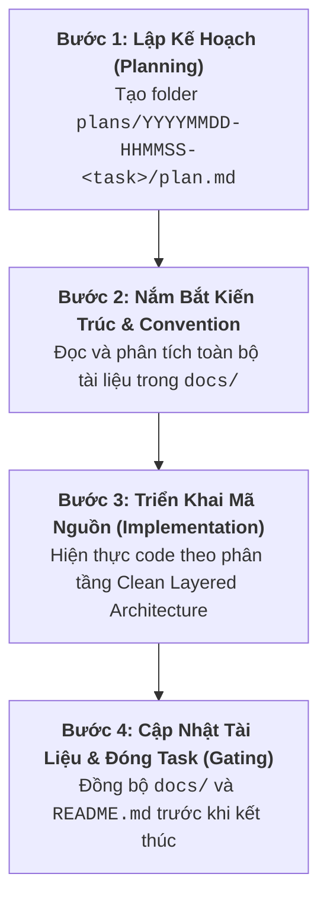

# AGENTS.md - Quy Tắc & Chuẩn Mực Phát Triển (Terra Clone)

Tài liệu này định nghĩa các nguyên tắc chỉ đạo, quy trình kỹ thuật bắt buộc và tiêu chuẩn chất lượng dành cho AI Agent khi làm việc trong dự án **Terra Clone**. Mọi hành động, đề xuất và thao tác mã nguồn của Agent phải tuân thủ nghiêm ngặt các quy định dưới đây.

---

## 1. 🧭 Tổng Quan Dự Án & Tech Stack

**Terra Clone** là nền tảng dịch vụ số và backend thương mại hiệu năng cao, xây dựng theo mô hình Monorepo kết hợp Clean Architecture, hỗ trợ đa môi trường từ Local/Dev đến Hardened Production:

- **API Gateway & Reverse Proxy**: Nginx (Docker internal DNS `127.0.0.11`, WebSocket HMR Upgrade, gzip compression, security headers).
- **Backend API Engine**: Golang 1.26+ với framework [Gin Gonic](https://github.com/gin-gonic/gin), ORM [GORM](https://gorm.io/) kết nối PostgreSQL 18 Connection Pool.
- **Observability & Logging**: `log/slog` (định dạng JSON có cấu trúc) kết hợp `lumberjack/v3` (tự động xoay vòng 10MB/file, nén `.gz`).
- **Cơ Sở Dữ Liệu**: PostgreSQL 18 Alpine, định danh khóa chính `UUIDv7`, trường dữ liệu mở rộng `JSONB` đánh chỉ mục `GIN Index`.
- **Database Migration**: `golang-migrate/v4` quản lý phiên bản với cặp tệp đồng bộ `.up.sql` và `.down.sql`.
- **Giao Diện Người Dùng**: Next.js / React (phân hệ `frontend/`).
- **Môi Trường & Đóng Gói**:
  - `dev` / `local` là một: [`docker-compose.yml`](file:///home/wsl-admin/projects/terra-clone/docker-compose.yml) tích hợp Air live-reload.
  - `staging`: [`docker-compose.staging.yml`](file:///home/wsl-admin/projects/terra-clone/docker-compose.staging.yml) (multi-stage build, user `1001:1001`).
  - `production`: [`docker-compose.product.yml`](file:///home/wsl-admin/projects/terra-clone/docker-compose.product.yml) (hardened minimal Alpine, user `10001:10001`).

---

## 2. ⚡ Quy Trình Phát Triển Bắt Buộc 4 Bước (The Mandatory 4-Step Engineering Workflow)

Mọi yêu cầu phát triển tính năng mới, tái cấu trúc mã nguồn (refactoring) hoặc sửa đổi logic hệ thống **BẮT BUỘC** phải tuân thủ chính xác quy trình 4 bước tuần tự sau:

### 🔴 Bước 1: Khởi Tạo Kế Hoạch Chi Tiết Trong `plans/`
- **Yêu cầu & Quy chuẩn cấu trúc thư mục Plan**:
  Trước khi chỉnh sửa hoặc tạo bất kỳ dòng code nào, Agent **bắt buộc** phải tạo một thư mục riêng biệt cho kế hoạch tại [`plans/`](file:///home/wsl-admin/projects/terra-clone/plans) với quy tắc đặt tên theo thời gian khởi tạo và nội dung tóm tắt:
  $$\text{plans/YYYYMMDD-HHMMSS-<noi-dung-plan-tom-tat>/}$$
  *(Ví dụ: `plans/20261021-155656-fix-ping-endpoint/`)*

  Cấu trúc tệp tin bên trong thư mục plan tuân thủ nghiêm ngặt 2 trường hợp:
  - **Trường hợp 1 - Kế hoạch đơn mục tiêu (Single Objective)**:
    - Nếu plan chỉ giải quyết một mục tiêu duy nhất: Bên trong thư mục mới tạo **chỉ có duy nhất 1 file** mang tên [`plan.md`](file:///home/wsl-admin/projects/terra-clone/plans) (ví dụ: `plans/20261021-155656-fix-ping-endpoint/plan.md`).
  - **Trường hợp 2 - Kế hoạch phức hợp gồm nhiều plan con (Multiple Sub-plans)**:
    - Nếu plan có nhiều hạng mục/mục tiêu con cần hoàn thành tuần tự hoặc độc lập:
      1. Tạo ra **nhiều file plan con** với tên gợi nhớ và nội dung tóm tắt cho từng phần (ví dụ: `01-migration-schema.md`, `02-auth-service.md`, v.v.).
      2. Đồng thời, **bắt buộc phải có một file kế hoạch tổng hợp** mang tên [`plan.md`](file:///home/wsl-admin/projects/terra-clone/plans) để xâu chuỗi toàn bộ các plan con, theo dõi tổng thể tiến độ và đóng vai trò là nguồn tham chiếu chuẩn cho cả nhiệm vụ.

- **Cấu trúc nội dung bắt buộc của file Plan (`plan.md`)**:
  1. **Mục tiêu & Phạm vi (Objectives & Scope)**: Xác định rõ ràng tính năng cần làm, liên kết với Product Design Requirement (PDR) và Roadmap.
  2. **Đánh giá Kiến trúc & Tác động CSDL (Architecture & Schema Impact)**:
     - Thiết kế Schema (bảng, cột, kiểu dữ liệu, index, migration number).
     - Thiết kế luồng dữ liệu một chiều qua các tầng.
     - Thiết kế cấu trúc Request/Response DTO và mã lỗi dự kiến.
  3. **Kế hoạch Triển khai Từng bước (Step-by-Step Implementation Steps)**:
     - Liệt kê tuần tự các file cần tạo mới hoặc cập nhật.
     - Xác định rõ nhiệm vụ của từng tầng: Migration -> Repository -> Service -> Controller -> Router/Middleware.
  4. **Kế hoạch Kiểm thử & Xác minh (Verification & Testing)**:
     - Các kịch bản kiểm thử (Test cases: Happy path & Edge cases).
     - Cách thức gọi API hoặc chạy kiểm thử kiểm tra tính năng.
  5. **Checklist Cập nhật Tài liệu (Documentation Checklist)**: Danh sách cụ thể các file trong `docs/` và `README.md` cần đồng bộ sau khi code xong.

### 🔴 Bước 2: Đọc Kỹ Tài Liệu Trong `docs/` Để Nắm Rõ Kiến Trúc & Convention
- **Yêu cầu**: Không bao giờ viết code dựa trên suy đoán. Agent phải đọc các tài liệu liên quan trong thư mục [`docs/`](file:///home/wsl-admin/projects/terra-clone/docs) để thấu hiểu tường tận thiết kế hiện có:
  - [`docs/design-guidelines.md`](file:///home/wsl-admin/projects/terra-clone/docs/design-guidelines.md): Quy chuẩn phân tầng Layered Clean Architecture, tiêu chuẩn đặt tên, quy tắc xử lý lỗi với `common.DefaultError`, chuẩn hóa DTO, phân trang Cursor, quy tắc viết SQL Migration, tiêu chuẩn logging.
  - [`docs/system-architecture.md`](file:///home/wsl-admin/projects/terra-clone/docs/system-architecture.md): Sơ đồ kiến trúc tổng thể, luồng request qua Nginx Gateway, mạng nội bộ Docker, cơ chế phân giải DNS.
  - [`docs/codebase-summary.md`](file:///home/wsl-admin/projects/terra-clone/docs/codebase-summary.md): Bản đồ phân rã toàn bộ mã nguồn, cấu trúc các package, vị trí và trách nhiệm của từng file trong dự án.
  - [`docs/project-overview-pdr.md`](file:///home/wsl-admin/projects/terra-clone/docs/project-overview-pdr.md): Nhu cầu nghiệp vụ, yêu cầu chức năng (FR-01 đến FR-08), yêu cầu phi chức năng (NFR) và ma trận truy vết.
  - [`docs/project-roadmap.md`](file:///home/wsl-admin/projects/terra-clone/docs/project-roadmap.md): Lộ trình 5 giai đoạn, các mốc quan trọng (Milestones) và trạng thái hiện tại của từng phân hệ.
  - [`docs/deployment-guide.md`](file:///home/wsl-admin/projects/terra-clone/docs/deployment-guide.md): Cẩm nang cấu hình môi trường, Docker Compose và danh mục lệnh Makefile.

### 🔴 Bước 3: Triển Khai Mã Nguồn Theo Đúng Plan
- **Yêu cầu**: Tiến hành viết code bám sát từng bước đã được duyệt trong file plan ở Bước 1.
- **Nguyên tắc phân tầng nghiêm ngặt (Layered Clean Architecture)**:
  $$\text{Transport (Controller)} \longrightarrow \text{Domain (Service)} \longrightarrow \text{Data (Repository)}$$
  - **Tầng Controllers (`server/controllers/`)**:
    - Tiếp nhận HTTP Request từ `gin.Context`.
    - Validate dữ liệu đầu vào (DTO Binding).
    - Gọi Service tương ứng, trả về `common.SuccessResponse` hoặc `common.DefaultError`.
    - **CẤM**: Không viết logic nghiệp vụ (business logic), không truy vấn trực tiếp Repository/Database.
  - **Tầng Services (`server/services/`)**:
    - Chứa toàn bộ logic nghiệp vụ, tính toán, điều phối và phân quyền.
    - Làm việc hoàn toàn với Go struct thuần túy và `context.Context`.
    - **CẤM**: Không phụ thuộc vào `gin.Context` hoặc bất kỳ đối tượng nào thuộc tầng HTTP Transport.
  - **Tầng Repositories (`server/repositories/`)**:
    - Đóng gói toàn bộ truy vấn CSDL qua GORM hoặc Raw SQL. Map kết quả vào Entity struct.
    - **CẤM**: Không đặt điều kiện logic nghiệp vụ tại tầng Repository.
- **Tiêu chuẩn xử lý lỗi & Logging**:
  - Không bao giờ nuốt lỗi (`_ = err`).
  - Lỗi phải được bọc bằng [`common.DefaultError`](file:///home/wsl-admin/projects/terra-clone/server/common/error_response.go) kèm `.WithTrace(err)` để lưu giữ StackTrace phục vụ debug.
  - Sử dụng `slog` có cấu trúc; tuyệt đối không log mật khẩu dạng plain-text, secret tokens hoặc PII nhạy cảm.
- **Cơ sở dữ liệu & Migrations**:
  - Mọi thay đổi bảng phải tạo cặp tệp `{number}_{name}.up.sql` và `{number}_{name}.down.sql` trong [`server/migrations/`](file:///home/wsl-admin/projects/terra-clone/server/migrations).
  - Khóa chính luôn dùng kiểu `UUID` mặc định `uuidv7()`.
  - Mọi bảng có đủ `created_at` và `updated_at` kiểu `TIMESTAMPTZ`.

### 🔴 Bước 4: Đồng Bộ Tài Liệu & Cổng Đóng Task Bắt Buộc (Mandatory Documentation Gate)
- **Yêu cầu**: Sau khi hoàn thiện mã nguồn và kiểm thử xác minh tính năng thành công, Agent **BẮT BUỘC** phải cập nhật toàn bộ các file tài liệu tương ứng:
  1. [`docs/codebase-summary.md`](file:///home/wsl-admin/projects/terra-clone/docs/codebase-summary.md):
     - Bổ sung cấu trúc thư mục, các file mới được tạo.
     - Mô tả chi tiết vai trò, hàm public và trách nhiệm của các module mới.
  2. [`docs/system-architecture.md`](file:///home/wsl-admin/projects/terra-clone/docs/system-architecture.md):
     - Cập nhật sơ đồ hệ thống (Mermaid) nếu có dịch vụ hoặc cổng giao tiếp mới.
     - Cập nhật luồng dữ liệu (Data Flow) hoặc danh sách endpoint mới.
  3. [`docs/deployment-guide.md`](file:///home/wsl-admin/projects/terra-clone/docs/deployment-guide.md):
     - Cập nhật biến môi trường mới vào danh sách đối chiếu.
     - Bổ sung các lệnh `make` mới hoặc thay đổi về quy trình build/run (nếu có).
  4. [`docs/project-roadmap.md`](file:///home/wsl-admin/projects/terra-clone/docs/project-roadmap.md):
     - Đánh dấu hoàn thành `[x]` cho các task/milestone thuộc giai đoạn tương ứng.
     - Cập nhật trạng thái tiến độ chung của toàn dự án.
  5. [`README.md`](file:///home/wsl-admin/projects/terra-clone/README.md):
     - Cập nhật mục lục, tính năng mới và sơ đồ thư mục dự án tương ứng.
  6. Thư mục Plan trong [`plans/`](file:///home/wsl-admin/projects/terra-clone/plans):
     - Đánh dấu hoàn thành toàn bộ checklist thực hiện trong thư mục `plans/YYYYMMDD-HHMMSS-<task>/plan.md` (và các plan con nếu có).

> [!CAUTION]
> ### ⛔ ĐIỀU KIỆN TIÊN QUYẾT: KHÔNG KẾT THÚC TASK NẾU CHƯA CẬP NHẬT TÀI LIỆU
> **Tuyệt đối KHÔNG ĐƯỢC PHÉP báo hoàn thành hoặc kết thúc task cho người dùng nếu chưa hoàn thành cập nhật các file trong `docs/` và `README.md`.**
> Bất kỳ task nào chỉ viết code mà không đồng bộ tài liệu được coi là **chưa hoàn thành (INCOMPLETE)** và vi phạm quy chuẩn dự án.

---

## 3. 🛡️ Quy Tắc An Toàn Hệ Thống & Vận Hành (Safety & Operational Constraints)

1. **Nhận thức về Môi trường (Environments)**:
   - `dev` và `local` là một. Luôn ưu tiên dùng `docker-compose.yml` và live-reload qua Air.
   - Khi chạy migration, sử dụng lệnh `make migrate-up` hoặc script tiêu chuẩn, kiểm tra cả file `up` lẫn `down`.
2. **Không commit bí mật (No Hardcoded Secrets)**:
   - Tuyệt đối không ghi cứng JWT Secret, DB Password, API Keys vào mã nguồn.
   - Mọi cấu hình phải nạp qua biến môi trường thông qua [`internal/config.go`](file:///home/wsl-admin/projects/terra-clone/server/internal/config.go).
   - Nếu thêm biến môi trường mới, bắt buộc cập nhật đồng thời file mẫu `.env.example` (cấp root và `server/.env.example`).
3. **Tính Bất Biến của Response Schema**:
   - Tất cả API trả về kết quả thành công phải bao bọc trong `common.SuccessResponse(c, statusCode, data, paging, extra)`.
   - Tất cả lỗi phải dùng `common.DefaultError` hoặc dẫn xuất của nó để đảm bảo tính nhất quán trên toàn hệ sinh thái.

---

## 4. 📋 Bảng Kiểm Tra Định Nghĩa Hoàn Thành (Definition of Done - DoD Checklist)

Trước khi thông báo hoàn tất bất kỳ chức năng nào tới người dùng, Agent phải tự rà soát theo checklist sau:

- [ ] Đã tạo thư mục theo định dạng `plans/YYYYMMDD-HHMMSS-<task>/` và file `plan.md` (kèm các plan con nếu có) ngay từ đầu task.
- [ ] Đã đọc và đối chiếu các quy chuẩn trong `docs/design-guidelines.md` và `docs/system-architecture.md`.
- [ ] Mã nguồn tuân thủ Clean Architecture: Controller $\rightarrow$ Service $\rightarrow$ Repository.
- [ ] Có migration `.up.sql` và `.down.sql` nếu có thay đổi CSDL; migration chạy trơn tru không lỗi.
- [ ] Đã xử lý lỗi chuẩn `common.DefaultError` với đầy đủ context và không nuốt lỗi.
- [ ] Đã cập nhật đầy đủ [`docs/codebase-summary.md`](file:///home/wsl-admin/projects/terra-clone/docs/codebase-summary.md).
- [ ] Đã cập nhật [`docs/system-architecture.md`](file:///home/wsl-admin/projects/terra-clone/docs/system-architecture.md) (nếu có thay đổi kiến trúc/endpoint).
- [ ] Đã cập nhật [`docs/deployment-guide.md`](file:///home/wsl-admin/projects/terra-clone/docs/deployment-guide.md) (nếu có thay đổi env/hạ tầng/make commands).
- [ ] Đã cập nhật tiến độ trong [`docs/project-roadmap.md`](file:///home/wsl-admin/projects/terra-clone/docs/project-roadmap.md).
- [ ] Đã cập nhật nội dung tương ứng trong [`README.md`](file:///home/wsl-admin/projects/terra-clone/README.md).
- [ ] Đã tích chọn hoàn thành checklist trong file `plan.md` tại `plans/YYYYMMDD-HHMMSS-<task>/`.
