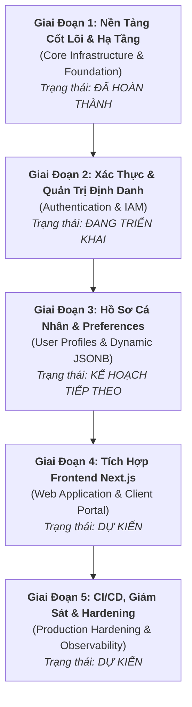

# 🗺️ Lộ Trình Phát Triển Dự Án (Project Roadmap)
## Dự án: Terra Clone

---

## 1. 🧭 Tổng Quan Lộ Trình (Roadmap Overview)

Lộ trình phát triển của dự án **Terra Clone** được chia thành 5 giai đoạn chiến lược, hướng tới việc xây dựng một nền tảng dịch vụ số hiện đại, hiệu năng cao và có khả năng chịu tải hàng triệu người dùng.

---

## 2. 📅 Chi Tiết Từng Giai Đoạn (Milestones Breakdown)

### 🟢 Giai Đoạn 1: Nền Tảng Hạ Tầng & Khung Kiến Trúc (Foundation & Core Infrastructure)
> **Trạng thái**: ✅ **ĐÃ HOÀN THÀNH (Baseline Achieved)**

- [x] **Cổng Dịch Vụ Gateway (Nginx)**:
  - Thiết lập reverse proxy với Docker internal DNS resolver (`127.0.0.11`).
  - Cấu hình điều hướng `/healthz`, `/api/*`, và `/*` kèm WebSocket Upgrade cho HMR.
  - Tối ưu gzip level 6, buffer size và security headers cho Production.
- [x] **Khung Backend Server (Golang 1.26+ & Gin Gonic)**:
  - Kiến trúc phân tầng Layered Clean Architecture ([`cmd/`](file:///home/wsl-admin/projects/terra-clone/server/cmd), [`internal/`](file:///home/wsl-admin/projects/terra-clone/server/internal), [`controllers/`](file:///home/wsl-admin/projects/terra-clone/server/controllers), [`services/`](file:///home/wsl-admin/projects/terra-clone/server/services), [`repositories/`](file:///home/wsl-admin/projects/terra-clone/server/repositories)).
  - Cơ chế nạp cấu hình và nguyên tắc thất bại sớm (Fail-Fast) trong [`config.go`](file:///home/wsl-admin/projects/terra-clone/server/internal/config.go).
  - Tích hợp Structured Logging JSON chuẩn `slog` và xoay vòng file tự động bằng `lumberjack/v3` với cơ chế bảo toàn log (`defer cleanupLogger()`).
  - Middleware ghi Access Log chi tiết theo thời gian thực tại [`middleware/logger.go`](file:///home/wsl-admin/projects/terra-clone/server/middleware/logger.go).
- [x] **Cơ Sở Dữ Liệu & Migrations**:
  - Khởi tạo PostgreSQL 18 trên nền tảng Alpine Linux siêu nhẹ.
  - Thiết kế và phiên bản hóa lược đồ ban đầu bằng `golang-migrate`:
    - [`000001_users_table`](file:///home/wsl-admin/projects/terra-clone/server/migrations/000001_users_table.up.sql): Khóa chính UUIDv7, unique email.
    - [`000002_user_credentials_table`](file:///home/wsl-admin/projects/terra-clone/server/migrations/000002_user_credentials_table.up.sql): Hỗ trợ tài khoản nội bộ và Social OAuth, chống brute-force, thu hồi token.
    - [`000003_user_profiles_table`](file:///home/wsl-admin/projects/terra-clone/server/migrations/000003_user_profiles_table.up.sql): Cột `preferences JSONB` đánh chỉ mục GIN.
- [x] **Chuẩn Hóa Giao Tiếp API**:
  - Chuẩn phản hồi lỗi phân cấp [`common.DefaultError`](file:///home/wsl-admin/projects/terra-clone/server/common/error_response.go) có StackTrace và Request ID.
  - Chuẩn phản hồi thành công [`common.SuccessResponse`](file:///home/wsl-admin/projects/terra-clone/server/common/success_response.go).
  - Phân trang con trỏ hiệu năng cao [`common.Paging`](file:///home/wsl-admin/projects/terra-clone/server/common/pagination.go).
- [x] **DevOps & Môi Trường**:
  - Thiết lập độc lập 3 file Compose: [`docker-compose.yml`](file:///home/wsl-admin/projects/terra-clone/docker-compose.yml) (Dev với Air live-reload), [`docker-compose.staging.yml`](file:///home/wsl-admin/projects/terra-clone/docker-compose.staging.yml) (Staging), [`docker-compose.product.yml`](file:///home/wsl-admin/projects/terra-clone/docker-compose.product.yml) (Production non-root 10001:10001).
  - Tự động hóa toàn diện qua [`Makefile`](file:///home/wsl-admin/projects/terra-clone/Makefile).

---

### 🟡 Giai Đoạn 2: Phân Hệ Xác Thực & Định Danh Người Dùng (Authentication & IAM)
> **Trạng thái**: 🚀 **ĐANG TRIỂN KHAI (In Progress - Priority 1)**

- [ ] **Data Access Layer (Repositories)**:
  - Hiện thực `UserRepository` (Tìm kiếm theo ID/Email, tạo mới tài khoản).
  - Hiện thực `CredentialRepository` (Lưu hash mật khẩu, cập nhật số lần thử sai, cập nhật `token_version`).
- [ ] **Business Logic Layer (Services)**:
  - Hiện thực hàm băm mật khẩu bảo mật sử dụng thuật toán `Argon2id` hoặc `Bcrypt` với salt ngẫu nhiên.
  - Logic đăng ký tài khoản (Register Flow) kết hợp transaction đảm bảo tạo đồng bộ bản ghi `users` và `user_credentials`.
  - Logic đăng nhập (Login Flow) kiểm tra số lần thử sai liên tiếp (`failed_login_attempts`), tự động kích hoạt `locked_until` nếu vượt quá 5 lần thử.
  - Cấp phát cặp JWT token: Access Token (thời hạn 15 phút) và Refresh Token (thời hạn 7 ngày).
- [ ] **HTTP Transport Layer (Controllers & Middleware)**:
  - Khởi tạo controller `AuthController`:
    - `POST /api/v1/auth/register`: Đăng ký tài khoản mới.
    - `POST /api/v1/auth/login`: Xác thực và trả JWT token.
    - `POST /api/v1/auth/refresh`: Cấp mới Access Token bằng Refresh Token.
    - `POST /api/v1/auth/logout`: Thu hồi token hiện tại.
    - `POST /api/v1/auth/logout-all`: Tăng `token_version` để đăng xuất khỏi toàn bộ thiết bị.
  - Middleware `AuthMiddleware`: Trích xuất Header `Authorization: Bearer <token>`, giải mã claims và xác thực với `token_version` trong CSDL.
- [ ] **Tích Hợp OAuth 2.0 (Google Login)**:
  - Endpoint `GET /api/v1/auth/google/callback`: Tiếp nhận authorization code, xác thực với Google Identity Server và tự động ánh xạ vào bảng `user_credentials`.

---

### 🔵 Giai Đoạn 3: Quản Lý Hồ Sơ & Cấu Hình Cá Nhân Hóa (User Profiles & Preferences)
> **Trạng thái**: 📋 **KẾ HOẠCH TIẾP THEO (Planned)**

- [ ] **CRUD Hồ Sơ Người Dùng**:
  - `GET /api/v1/users/me`: Trích xuất thông tin hồ sơ của tài khoản đang đăng nhập.
  - `PATCH /api/v1/users/me`: Cập nhật ngày sinh, giới tính, số điện thoại, địa chỉ.
- [ ] **Tải Lên Ảnh Đại Diện (Avatar Upload Pipeline)**:
  - Tích hợp giải pháp lưu trữ đối tượng (S3-compatible: AWS S3 hoặc MinIO container).
  - Cung cấp API sinh Presigned URL an toàn để client tải ảnh trực tiếp lên storage.
- [ ] **Khai Thác Cấu Hình Động (JSONB Preferences)**:
  - Viết Service hỗ trợ cập nhật một phần cấu hình JSONB (`jsonb_set` trong PostgreSQL) cho các cài đặt: Giao diện (Dark/Light mode), Tần suất thông báo, Ngôn ngữ hiển thị.
  - Tối ưu hóa truy vấn tìm kiếm người dùng theo điều kiện cấu hình sử dụng toán tử JSONB `@>`.
- [ ] **Phân Quyền & Quản Trị Hệ Thống (Admin APIs)**:
  - Quản lý danh sách người dùng với phân trang Cursor.
  - Khóa tài khoản cưỡng chế (chuyển trạng thái `status = 'deleted'` hoặc `'inactive'`).

---

### 🟣 Giai Đoạn 4: Phát Triển Giao Diện Web (Frontend Next.js Integration)
> **Trạng thái**: ⏳ **DỰ KIẾN (Upcoming)**

- [ ] **Khởi Tạo Dự Án Web Frontend**:
  - Khởi tạo dự án Next.js 14+ (App Router, React Server Components, TypeScript, Tailwind CSS, Shadcn UI).
  - Cấu hình kết nối qua Nginx Gateway tại cổng `:8088`.
- [ ] **Hiện Thực Các Luồng Giao Diện Người Dùng**:
  - Trang xác thực: Đăng nhập, Đăng ký, Quên mật khẩu, Nút đăng nhập Google OAuth.
  - Trang quản lý thông tin tài khoản và cài đặt Preferences.
  - Trang Dashboard chính của dịch vụ Terra Clone.
- [ ] **Quản Lý Trạng Thái & Đồng Bộ Dữ Liệu**:
  - Xử lý Cookie HTTP-only an toàn cho Refresh Token.
  - Sử dụng thư viện React Query / SWR quản lý cache API và tự động refresh token ngầm khi Access Token hết hạn.

---

### ⚪ Giai Đoạn 5: CI/CD, Quan Sát & Tối Ưu Triển Khai (Hardening & Observability)
> **Trạng thái**: ⏳ **DỰ KIẾN (Upcoming)**

- [ ] **Quy Trình Tích Hợp & Triển Khai Liên Tục (CI/CD Pipeline)**:
  - Cấu hình GitHub Actions: Tự động chạy `golangci-lint`, kiểm thử đơn vị (`go test ./...`) và kiểm thử tích hợp.
  - Tự động đóng gói và đẩy Docker image lên GitHub Container Registry (GHCR) khi gắn tag release.
- [ ] **Bộ Đệm Dữ Liệu Tốc Độ Cao (Redis Cache)**:
  - Bổ sung service Redis vào Docker Compose phục vụ lưu trữ blacklist token tạm thời và Rate Limiting chống spam request.
- [ ] **Hệ Thống Giám Sát & Cảnh Báo (Metrics & Monitoring)**:
  - Tích hợp Prometheus client thu thập metrics hiệu năng (RPS, Latency, Số lượng kết nối DB pool).
  - Trực quan hóa dashboard giám sát với Grafana.
  - Cấu hình công cụ Distributed Tracing (OpenTelemetry / Jaeger) truy vết request end-to-end từ Nginx qua Go Server đến Database.
