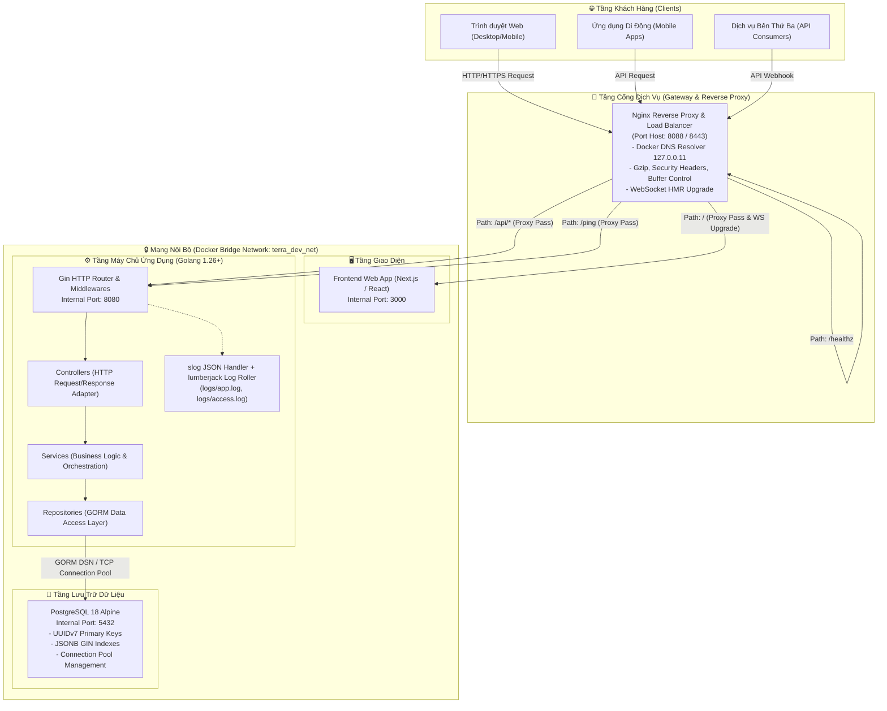
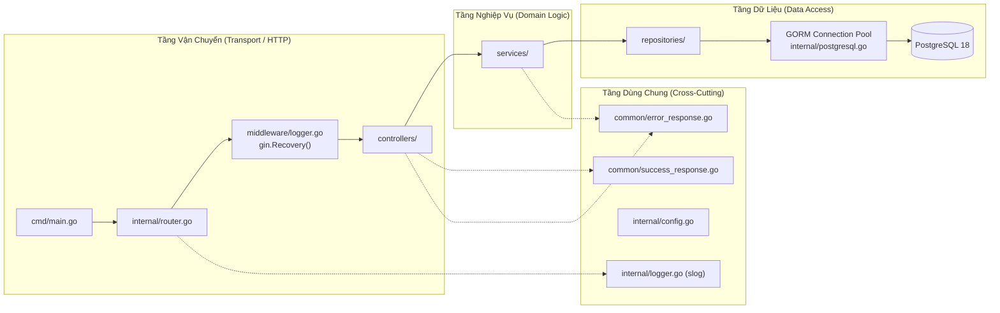
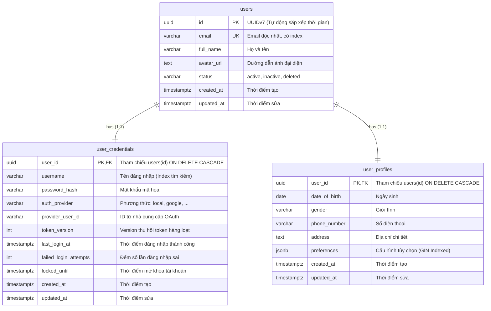
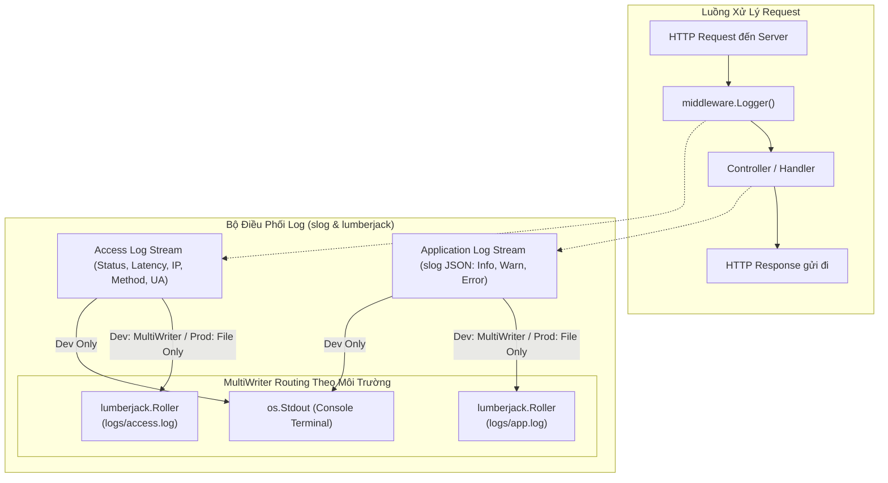

# 🏛️ Tài Liệu Kiến Trúc Hệ Thống (System Architecture Document)
## Dự án: Terra Clone

---

## 1. 🌐 Tổng quan Kiến trúc Hệ thống (High-Level Architecture)

Dự án **Terra Clone** được thiết kế theo mô hình Monorepo kết hợp Microservices-ready với các nguyên lý cốt lõi:
- **Loose Coupling (Khớp nối lỏng)**: Tách biệt hoàn toàn giữa Gateway điều phối lưu lượng, API Server xử lý nghiệp vụ, CSDL quan hệ và Giao diện người dùng.
- **High Performance & Low Latency**: Ứng dụng Golang và Gin Gonic cho tầng xử lý backend, kết hợp Nginx Reverse Proxy tối ưu hóa I/O và gzip.
- **Fail-safe & Observability**: Tự động phục hồi kết nối, giám sát trạng thái sức khỏe đa tầng, ghi nhận structured log chuẩn JSON có truy vết chi tiết.

### Sơ đồ Kiến trúc Tổng thể (System Diagram)



---

## 2. 🚪 Tầng Cổng Dịch vụ (API Gateway & Nginx Reverse Proxy)

Cổng vào duy nhất của hệ thống được quản trị bởi **Nginx**, định nghĩa tại thư mục [nginx/](file:///home/wsl-admin/projects/terra-clone/nginx).

### 2.1. Dynamic DNS Resolution
Nginx sử dụng cơ chế phân giải tên miền động của Docker:
```nginx
resolver 127.0.0.11 valid=30s ipv6=off;
```
- **Ý nghĩa kỹ thuật**: Ngăn ngừa lỗi "host not found in upstream" khi khởi động Nginx trước khi các container Go Server hoặc Frontend hoàn tất khởi động. Nginx sẽ resolve IP của service runtime thay vì cố định tại thời điểm nạp cấu hình.

### 2.2. Chiến lược Định tuyến (Routing Policy)
1. **Health Check Endpoint (`GET /healthz`)**:
   - Trả về `200 "healthy\n"` tức thời mà không ghi access log, phục vụ Load Balancer kiểm tra liveness.
2. **Ping / Liveness Endpoint (`GET /ping` & `GET /api/ping`)**:
   - Chuyển tiếp tới backend server qua biến upstream `$backend_upstream http://server:8080`, trả về `{"message": "pong"}`.
3. **API Routing (`/api/*`)**:
   - Chuyển tiếp tới backend server qua biến upstream `$backend_upstream http://server:8080`.
   - Forwarding các header bảo mật và định danh mạng: `Host`, `X-Real-IP`, `X-Forwarded-For`, `X-Forwarded-Proto`.
4. **Frontend Routing (`/*`)**:
   - Chuyển tiếp tới Next.js frontend qua biến upstream `$frontend_upstream http://frontend:3000`.
   - Kèm các chỉ thị WebSocket (`Upgrade $http_upgrade`, `Connection "upgrade"`) đảm bảo Hot Module Replacement (HMR) trong môi trường phát triển hoạt động liên tục.

### 2.3. Tối ưu Hóa & Bảo mật Tầng Gateway
- **HTTP Compression**: Bật `gzip on` (Level 6) cho các định dạng MIME: `application/json`, `text/javascript`, `application/xml`, `image/svg+xml`,...
- **Client Body Limits**: Giới hạn kích thước payload tối đa `client_max_body_size 50M` và kích thước bộ đệm `client_body_buffer_size 128k`.
- **Security Headers (Production)**: Thiết lập chặt chẽ trong [product.conf](file:///home/wsl-admin/projects/terra-clone/nginx/conf.d/product.conf#L8-L14) gồm `X-Frame-Options`, `X-Content-Type-Options`, `X-XSS-Protection`, `Referrer-Policy`.

---

## 3. ⚙️ Tầng Xử lý Nghiệp vụ (Backend Architecture - Golang)

Toàn bộ mã nguồn backend nằm trong thư mục [server/](file:///home/wsl-admin/projects/terra-clone/server), áp dụng mô hình **Clean / Layered Architecture**.



### 3.1. Chi tiết Trách nhiệm Từng Tầng
1. **Entrypoint ([`server/cmd/main.go`](file:///home/wsl-admin/projects/terra-clone/server/cmd/main.go))**: Điểm khởi động tối giản, gọi hàm điều phối vòng đời [`internal.Run()`](file:///home/wsl-admin/projects/terra-clone/server/internal/run.go#L8-L36).
2. **Cấu hình & Kết nối ([`server/internal/config.go`](file:///home/wsl-admin/projects/terra-clone/server/internal/config.go) & [`postgresql.go`](file:///home/wsl-admin/projects/terra-clone/server/internal/postgresql.go))**:
   - `NewConfig()` nạp file `.env` hoặc biến môi trường hệ thống, xác thực tính hợp lệ của các thông số bắt buộc (`PORT`, `DB_HOST`, `DB_NAME`).
   - `ConnectDb()` khởi tạo kết nối GORM PostgreSQL và thực hiện lệnh `Ping()` để kiểm tra sức khỏe của Connection Pool trước khi phục vụ request.
3. **HTTP Engine ([`server/internal/router.go`](file:///home/wsl-admin/projects/terra-clone/server/internal/router.go))**:
   - Khởi tạo `gin.New()` với chế độ phân tách rõ ràng (`gin.ReleaseMode` trên Staging/Production).
   - Tích hợp Middleware ghi access log [`middleware.Logger`](file:///home/wsl-admin/projects/terra-clone/server/middleware/logger.go) và phục hồi sự cố [`gin.Recovery()`](file:///home/wsl-admin/projects/terra-clone/server/internal/router.go#L17).
4. **Controllers (`server/controllers/`)**: Tiếp nhận `gin.Context`, phân tích (bind) dữ liệu đầu vào, gọi Service tương ứng và định dạng kết quả qua `common.SuccessResponse` hoặc `common.DefaultError`.
5. **Services (`server/services/`)**: Hiện thực nghiệp vụ cốt lõi, xác thực điều kiện kinh doanh, điều phối giao tác (transactions) và không phụ thuộc vào framework HTTP.
6. **Repositories (`server/repositories/`)**: Đóng gói các câu truy vấn GORM/SQL, tương tác với database và map dữ liệu về các entity struct.

### 3.2. Vòng đời Ứng dụng & Quản lý Log Flush (Lifecycle Management)
Trong [`server/internal/run.go`](file:///home/wsl-admin/projects/terra-clone/server/internal/run.go#L19-L23), hàm `InitLogger` trả về một hàm closure `cleanupLogger()` được gọi qua `defer`:
```go
defer func() {
    if err := cleanupLogger(); err != nil {
        fmt.Printf("[VN] Lỗi khi đóng log roller: %v\n", err)
    }
}()
```
Cơ chế này bảo đảm **Zero Log Loss**: khi tiến trình Go nhận tín hiệu dừng (SIGTERM/SIGINT), toàn bộ các bản ghi log còn lưu trong bộ đệm RAM của `lumberjack.Roller` sẽ được đẩy (flush) hoàn toàn xuống đĩa cứng trước khi tiến trình kết thúc.

---

## 4. 💾 Tầng Cơ sở Dữ liệu & Thiết kế Lược đồ (Database Architecture)

Hệ thống sử dụng **PostgreSQL 18** với lược đồ được phiên bản hóa hoàn toàn qua [server/migrations/](file:///home/wsl-admin/projects/terra-clone/server/migrations).

### 4.1. Sơ đồ Thực thể - Mối quan hệ (Entity-Relationship Diagram)



### 4.2. Các Đặc Điểm Thiết Kế Đột Phá
1. **Khóa Chính `UUIDv7`**:
   - Khắc phục nhược điểm phân mảnh chỉ mục (B-tree index fragmentation) của UUIDv4 truyền thống.
   - 48-bit đầu tiên chứa Unix timestamp theo mili-giây, giúp dữ liệu mới chèn luôn có tính tuần tự, tối ưu hóa tốc độ ghi và phân trang.
2. **Cơ chế Chống Tấn Công Brute-Force**:
   - Trường `failed_login_attempts` kết hợp với `locked_until` cho phép khóa tạm thời tài khoản khi phát hiện số lần thử sai vượt ngưỡng mà không cần công cụ Redis trung gian ở giai đoạn khởi đầu.
3. **Cơ chế Vô Hiệu Hóa Token Tức Thì (`token_version`)**:
   - Khi tạo JWT token, giá trị `token_version` hiện tại được đóng gói vào payload claims.
   - Khi người dùng đổi mật khẩu hoặc click "Đăng xuất khỏi mọi thiết bị", hệ thống chỉ cần tăng `token_version` trong CSDL. Mọi request với token cũ sẽ bị từ chối ngay lập tức tại Auth Middleware.
4. **Tối ưu Hóa Truy Vấn Không Đồng Nhất Với `JSONB` & Chỉ mục `GIN`**:
   - Cột `preferences` trong bảng `user_profiles` lưu trữ cấu hình cá nhân hóa tùy biến.
   - Chỉ mục `idx_user_profiles_preferences` kiểu **GIN** hỗ trợ các phép toán kiểm tra tập con `@>` và khóa tồn tại `?` với tốc độ tiệm cận truy vấn trên các cột quan hệ thông thường.

---

## 5. 📊 Hệ thống Ghi Log & Khả năng Quan sát (Logging & Observability)



- **Tiêu chuẩn cấu hình xoay vòng log**:
  - Tối đa 10MB cho mỗi file log.
  - Lưu trữ tối đa 5 file lịch sử, thời hạn 28 ngày.
  - Tự động nén thành file định dạng `.gz` giúp tiết kiệm tới 85% dung lượng đĩa cứng.

---

## 6. 🐳 Mạng Môi trường & Điều phối Container (Network & Docker)

Hệ thống điều phối qua 3 file cấu hình độc lập:
1. **[docker-compose.yml](file:///home/wsl-admin/projects/terra-clone/docker-compose.yml)**: Dành riêng cho **Dev / Local**, mount source code trực tiếp, kích hoạt Air live-reload.
2. **[docker-compose.staging.yml](file:///home/wsl-admin/projects/terra-clone/docker-compose.staging.yml)**: Dành cho **Staging**, sử dụng Dockerfile multi-stage, chạy non-root user `1001:1001`.
3. **[docker-compose.product.yml](file:///home/wsl-admin/projects/terra-clone/docker-compose.product.yml)**: Dành cho **Production**, hardened image `alpine:3.24`, nhị phân stripped (`-ldflags="-s -w"`), non-root `10001:10001`, cô lập cổng PostgreSQL chỉ mở trong mạng nội bộ `terra_prod_network`.
